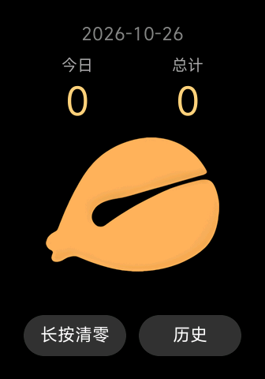

# 功德木鱼 · Merit Wooden Fish

小米手环 10 Pro 上的电子木鱼（Vela 快应用）。
An electronic wooden fish for Xiaomi Smart Band 10 Pro (Vela quick app).



[中文](#中文) · [English](#english)

---

## 中文

### 功能
- 敲木鱼：功德 +1，手环短振
- 今日 / 总计 两个计数
- 长按「清零」：只清今天
- 历史页：按天记录，零点自动切换；长按可清空历史
- 数据只存在手环本地，不联网

### 安装
1. 下载 `.rpk` 安装包（见 Releases），或按下方步骤自己构建
2. 用 [AstroBox](https://github.com/AstralSightStudios/AstroBox-NG) 蓝牙连接手环，导入 `.rpk` 安装（需要手环 authkey，按 AstroBox / 米坛教程获取）

### 构建
```bash
npm install
npx aiot build        # 产物：dist/com.zw.muyu.debug.<版本>.rpk
./run-emu.sh          # 可选：重启 Vela 模拟器并截图到 shot/latest.png
```
需要 Node.js 和 aiot-toolkit 2.x；模拟器用 Vela_Band（vela-watch-5.0，336×480）。

### 代码结构
| 路径 | 作用 |
| --- | --- |
| `src/pages/index` | 主页：计数、敲木鱼、清零 |
| `src/pages/history` | 历史页：返回按钮 / 右滑返回 |
| `src/common/store.js` | 本地存储，读写串行，跨零点自动归档 |
| `src/common/hold.js` | 自制长按（800 ms，移动超 12 px 取消） |

---

## English

### Features
- Tap the fish: +1 merit with a short vibration
- Today and all-time counters
- Long-press **Reset** to clear today only
- Daily history that rolls over at midnight; long-press to clear it
- All data stays on the band, no network

### Install
1. Get the `.rpk` from Releases, or build it yourself (below)
2. Sideload it with [AstroBox](https://github.com/AstralSightStudios/AstroBox-NG) over Bluetooth (requires your band's authkey)

### Build
```bash
npm install
npx aiot build        # output: dist/com.zw.muyu.debug.<version>.rpk
./run-emu.sh          # optional: restart the Vela emulator and screenshot to shot/latest.png
```
Requires Node.js and aiot-toolkit 2.x. Emulator: Vela_Band (vela-watch-5.0, 336×480).

### Notes
- Vibration only works on a real device, not in the emulator.
- The UI text is Chinese only.
